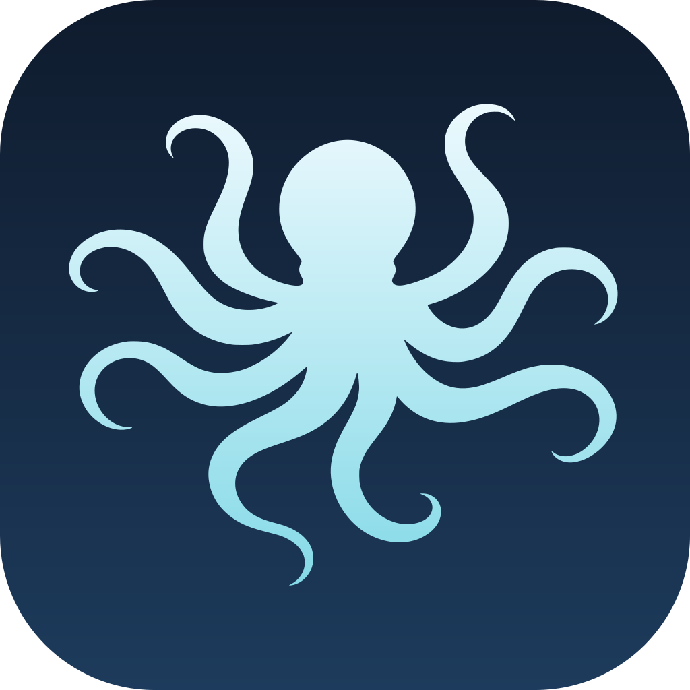
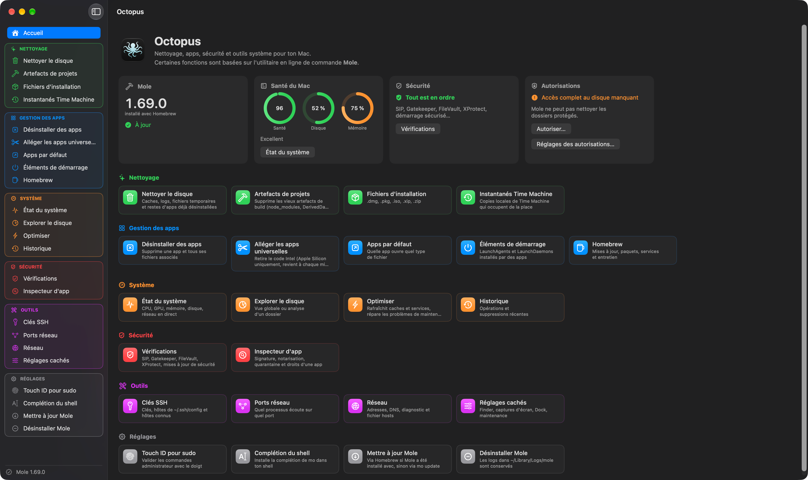
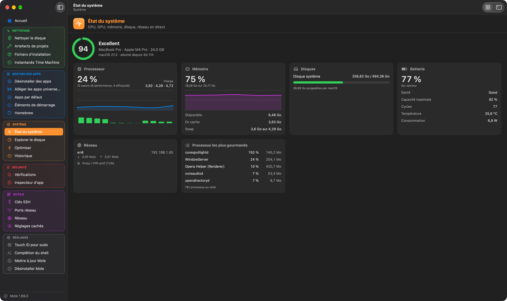
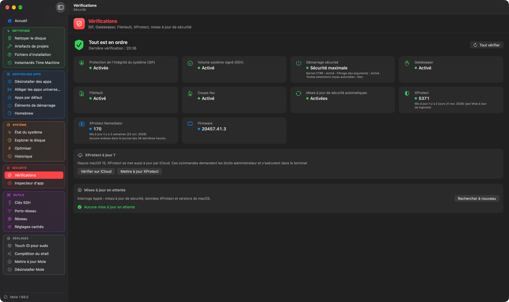
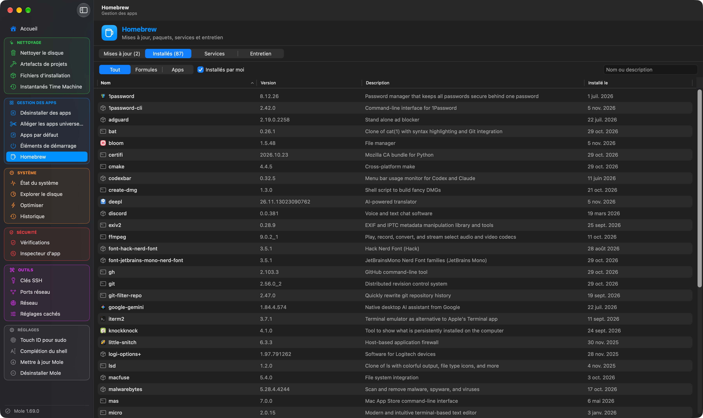
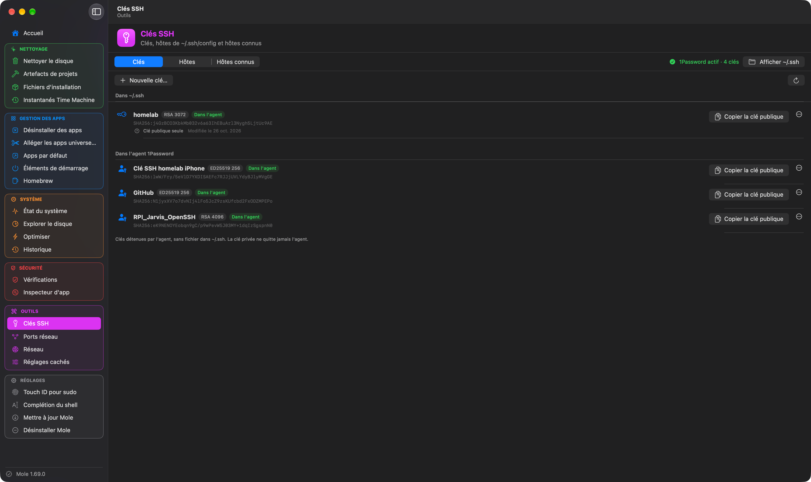

<p align="center">
  
</p>

<h1 align="center">Octopus</h1>

<p align="center">
  <a href="https://github.com/Aervorn/MacOS_Octopus/releases/latest"></a>
  
  
  <a href="LICENSE"></a>
</p>

<p align="center">
  <a href="README.md">🇬🇧 English</a> · 🇫🇷 Français
</p>

---

Octopus prend soin de ton Mac : nettoyage, gestion des apps, vérifications de sécurité et outils système, dans une seule fenêtre macOS native.

Ses fonctions de nettoyage et d'entretien sont une interface graphique pour [Mole](https://github.com/tw93/Mole), l'outil en ligne de commande de tw93 : toutes les commandes de Mole, y compris celles absentes du menu de `mo`, sont rangées par catégorie avec leurs options en cases à cocher, et s'exécutent dans un vrai terminal intégré (les écrans interactifs de Mole, `sudo` et Touch ID fonctionnent comme dans le Terminal). Autour, Octopus ajoute ses propres outils natifs : vérifications de sécurité dans l'esprit de [SilentKnight](https://eclecticlight.co/lockrattler-systhist/), clés SSH, ports réseau, éléments de démarrage, Homebrew, réglages cachés et plus encore.

Octopus est disponible en français et en anglais, selon la langue de ton Mac ou celle choisie dans ses réglages.

> [!NOTE]
> **Fait avec l'aide de l'IA.** Octopus est un projet personnel, construit avec [Claude](https://claude.ai), l'assistant IA d'Anthropic : mes compétences seules n'auraient pas suffi à le coder entièrement moi-même. J'ai décidé de ce que l'app devait faire, fait les choix de conception et testé chaque version sur mon propre Mac ; Claude a écrit une grande partie du code. Autant le dire franchement.

> [!IMPORTANT]
> **Octopus n'est pas affilié à Mole ni à son auteur.** Il pilote le `mo` installé sur ton Mac, sans le modifier. Les commandes qui suppriment des fichiers sont celles de Mole : prévisualise-les d'abord.

## 📸 Captures d'écran

<p align="center">
  
</p>

| État du système | Vérifications de sécurité |
|:---:|:---:|
|  |  |
| **Homebrew** | **Clés SSH** |
|  |  |

## ✨ Fonctionnalités

### 🏠 Accueil

La santé du Mac, le disque et la mémoire en un coup d'œil, le résultat des vérifications de sécurité, la version de Mole installée (avec un bouton de mise à jour quand une nouvelle sort), l'état de l'accès complet au disque, et une tuile pour chaque outil.

### 🧹 Nettoyage (Mole)

- **Nettoyer le disque** : caches, logs, fichiers temporaires et restes d'apps déjà désinstallées. Les chemins protégés sont modifiables.
- **Artefacts de projets** : vieux artefacts de build (`node_modules`, `DerivedData`…), avec les dossiers à scanner.
- **Fichiers d'installation** : `.dmg`, `.pkg`, `.iso`, `.xip`, `.zip` qui traînent.
- **Instantanés Time Machine** : les copies locales, leur taille, et leur suppression.
- **Aperçu d'abord** : `--dry-run` est coché par défaut sur toutes les commandes qui suppriment ; une vraie exécution demande confirmation. La ligne de commande générée est toujours affichée avant le lancement.

### 📦 Gestion des apps

- **Désinstaller des apps** (Mole) : une app et tous ses fichiers associés.
- **Alléger les apps universelles** (Mole, Apple Silicon) : retire le code Intel.
- **Apps par défaut** : quelle app ouvre quel type de fichier ou de lien, et la changer.
- **Éléments de démarrage** : LaunchAgents et LaunchDaemons installés par des apps, avec leur signature ; les activer, désactiver ou afficher, plusieurs à la fois.
- **Homebrew** : paquets à mettre à jour et mise à jour en un clic, formules et casks installés (avec l'icône de l'app de chaque cask), services, nettoyage et `autoremove`. Octopus détecte et répare aussi un cask bloqué sur « already an App at… ». Un paquet peut être exclu des mises à jour (une app qui se met à jour toute seule, par exemple) et réintégré à tout moment.

### 📊 Système (Mole)

- **État du système** : CPU, GPU, mémoire, disques, réseau, batterie et processus les plus gourmands, en direct.
- **Explorer le disque** : les plus gros dossiers et fichiers du Mac ou d'un dossier, triables, avec affichage dans le Finder.
- **Optimiser** : rafraîchit les caches et services système, et lance les tâches d'entretien sans risque.
- **Historique** : les opérations et suppressions récentes de Mole.

### 🛡️ Sécurité

- **Vérifications** : SIP, volume système signé, politique de démarrage sécurisé, Gatekeeper, FileVault, coupe-feu, mises à jour automatiques, XProtect et ses derniers scans, firmware, et mises à jour macOS et de sécurité en attente (vérifiées à l'ouverture de la vue).
- **Inspecteur d'app** : qui a signé une app, si elle vient de l'App Store ou est notarisée (une analyse automatique d'Apple, pas un examen), si elle est dans un bac à sable, sa quarantaine et ses droits (entitlements) ; retrait de l'attribut de quarantaine. Les vérifications brutes `spctl` et `codesign` peuvent aussi être lancées dans le terminal.

### 🧰 Outils

- **Clés SSH** : tes clés et celles de l'agent (1Password compris), les hôtes de `~/.ssh/config` avec un éditeur en formulaire, les hôtes connus, le test de connexion, et l'envoi d'une clé publique vers un hôte.
- **Ports réseau** : quel processus écoute sur quel port, avec sa ligne de commande ; processus root compris, avec Touch ID.
- **Réseau** : adresses, routeur, DNS et IP publique, diagnostic (ping, traceroute, résolution DNS, vidage du cache DNS) et éditeur du fichier `hosts`.
- **Réglages cachés** : options du Finder, des captures d'écran, du Dock et de maintenance, d'habitude accessibles seulement avec `defaults write`.

### ⚙️ Mole lui-même

Touch ID pour `sudo`, complétion du shell, et mises à jour de Mole : Octopus repère une nouvelle version et la met à jour avec Homebrew ou `mo update`, selon la façon dont Mole a été installé. Si Mole est absent, Octopus propose de l'installer.

### 🎨 Interface

Français ou anglais, mode clair, sombre ou automatique, sections de la barre latérale et en-têtes des outils colorés par catégorie, et terminal intégré ([SwiftTerm](https://github.com/migueldeicaza/SwiftTerm)) pour la sortie en couleurs de Mole et ses écrans au clavier.

## 🧩 Compatibilité

**macOS 14 (Sonoma) ou plus récent**, sur Mac Apple Silicon et Intel. L'icône s'adapte aux styles d'icônes clair, sombre, transparent et teinté de macOS 26.

[Mole](https://github.com/tw93/Mole) est nécessaire pour les fonctions de nettoyage, de désinstallation d'apps et de système : Octopus peut l'installer pour toi. Les autres outils fonctionnent sans. Homebrew n'est nécessaire que pour la vue Homebrew.

## 🔐 Autorisations

| Autorisation | Pourquoi | Quand |
|---|---|---|
| **Accès complet au disque** | Permet à Mole de nettoyer les dossiers protégés, et aux vérifications de sécurité de lire les journaux système. | Proposé au premier lancement ; possible plus tard depuis **Réglages › Autorisations**. |
| **Mot de passe administrateur / Touch ID** | Les commandes qui demandent root (certaines vérifications, ports root, instantanés, `hosts`). | Seulement quand tu en lances une. Touch ID est utilisé s'il est activé pour `sudo`. |
| **1Password** (facultatif) | Utiliser les clés de l'agent SSH de 1Password. | Quand une connexion SSH a besoin d'une clé. |

## 🔒 Confidentialité

Octopus ne collecte et n'envoie rien sur toi : pas de compte, pas de statistiques, pas de pistage. Les seules requêtes réseau qu'il fait lui-même sont :

- la dernière version de Mole (GitHub) ;
- ton adresse IP publique, dans la vue Réseau ([ipify](https://www.ipify.org)) ;
- les mises à jour d'Octopus (ce dépôt GitHub) ;
- les outils que tu lances (Homebrew, `softwareupdate`, ping, SSH…), exactement comme depuis le Terminal.

## 📥 Installation

1. Télécharge `Octopus-x.y.z.dmg` depuis la [dernière version](https://github.com/Aervorn/MacOS_Octopus/releases/latest).
2. Ouvre-le et fais glisser **Octopus** sur le dossier **Applications**.
3. Lance Octopus depuis ton dossier Applications.

> [!WARNING]
> **Octopus n'est pas notarisé par Apple.** Il est signé avec le certificat de l'auteur, pas avec un compte Apple Developer payant, donc macOS le bloque à la première ouverture. C'est normal, il suffit de l'autoriser une fois :
>
> 1. Ouvre Octopus : macOS indique qu'il ne peut pas le vérifier. Clique sur **Terminé**.
> 2. Ouvre **Réglages Système › Confidentialité et sécurité** et descends jusqu'à la section **Sécurité**.
> 3. À côté du message concernant Octopus, clique sur **Ouvrir quand même**, puis confirme avec ton mot de passe.
>
> Si tu préfères le Terminal : `xattr -dr com.apple.quarantine /Applications/Octopus.app`
>
> Tu peux vérifier que le téléchargement est authentique en comparant son empreinte SHA-256 (`shasum -a 256 Octopus-x.y.z.dmg`) avec celle indiquée dans les notes de version.

## 🔄 Mettre à jour

Octopus se met à jour tout seul : il vérifie une fois par jour si une nouvelle version existe et propose de l'installer, avec ses notes de version (ou **Octopus › Rechercher les mises à jour…**). Les mises à jour sont signées, et Octopus refuse tout fichier qui n'a pas été signé par l'auteur. La vérification automatique se désactive dans **Réglages › Général**.

## 📝 Historique des versions

### 0.2.0
- Chaque outil a désormais son propre terminal : changer d'outil n'affiche plus la commande de l'outil précédent.
- Homebrew : exclure un paquet des mises à jour (clic droit), puis le réintégrer plus tard.
- Inspecteur d'app : bac à sable toujours indiqué, ce que la notarisation garantit ou non, chaîne de signature complète, et un bouton qui lance `spctl` et `codesign` dans le terminal.
- Description plus claire d'**Optimiser**.
- Fermer la fenêtre principale quitte maintenant Octopus, au lieu de laisser la fenêtre des Réglages ouverte.

### 0.1.0
- Première version publique, en français et en anglais.
- Toutes les commandes de Mole avec leurs options, exécutées dans un terminal intégré ; installation et mise à jour de Mole.
- Vues natives pour l'état du système, l'explorateur de disque et l'historique.
- Vérifications de sécurité, inspecteur d'app, clés SSH, ports réseau, réseau, éléments de démarrage, Homebrew, instantanés Time Machine, apps par défaut et réglages cachés.
- Vue d'accueil, mode clair et sombre, fenêtre **À propos**, icône conçue pour macOS 26, mises à jour Sparkle.

## 🛠️ Compiler depuis les sources

Prérequis : Xcode 26 ou plus récent et [XcodeGen](https://github.com/yonaskolb/XcodeGen) (le projet Xcode est généré depuis `project.yml`).

```bash
brew install xcodegen
git clone https://github.com/Aervorn/MacOS_Octopus.git
cd MacOS_Octopus
xcodegen generate
open Octopus.xcodeproj
```

Choisis le schéma **Octopus** et **Mon Mac**, puis **Product › Run** (⌘R). Le projet est réglé sur **Sign to Run Locally** : aucun compte développeur Apple n'est nécessaire. Après un `git pull` qui ajoute ou supprime des fichiers, relance `xcodegen generate`.

```
Octopus/
├── OctopusApp.swift        point d'entrée, fenêtres et menus
├── Core/                   modèles des sorties JSON de Mole, catalogue des commandes, formatage
├── Services/               Mole, terminal, vérifications de sécurité, SSH, Homebrew, réseau, mises à jour…
├── Views/                  interface SwiftUI (outils natifs dans Views/Native)
├── Resources/              mole-commands.json : le catalogue des commandes de Mole et de leurs options
└── AppIcon.icon            icône de l'app (Icon Composer)
Design/                     calques de l'icône, fond du DMG et les scripts qui les génèrent
scripts/make-dmg.sh         fabrique le DMG d'une version et l'appcast Sparkle
```

Les commandes de Mole sont décrites dans `Octopus/Resources/mole-commands.json` (titre, options, actions) : une nouvelle option de Mole n'y demande en général qu'une ligne.

Pour fabriquer un DMG comme ceux publiés, `scripts/make-dmg.sh` génère le projet, archive l'app, vérifie sa signature et crée l'image disque. Il faut [create-dmg](https://github.com/create-dmg/create-dmg) (`brew install create-dmg`) et un certificat de signature, dont le nom se règle en haut du script. Il signe aussi le DMG pour Sparkle et réécrit `appcast.xml`, ce qui demande une clé EdDSA dans ton trousseau (`generate_keys`, fourni avec Sparkle) dont la partie publique est dans `project.yml`.

## 🤝 Contribuer et signaler un problème

Les signalements de bugs, idées et pull requests sont les bienvenus !

- **Un bug ?** [Ouvre une issue](https://github.com/Aervorn/MacOS_Octopus/issues/new) avec ta version de macOS, ta version de Mole (`mo --version`), ce que tu as fait et ce qui s'est passé.
- **Un problème avec un nettoyage lui-même ?** Il vient sans doute de Mole : vérifie s'il se produit aussi avec `mo` dans le Terminal, et si oui, signale-le sur le [dépôt de Mole](https://github.com/tw93/Mole/issues).
- **Une pull request ?** Garde-la centrée sur un seul changement. Les textes de l'interface sont écrits en français dans le code et traduits dans `Octopus/Resources/Localizable.xcstrings` (et `Commands.xcstrings` pour les commandes de Mole).

## ⚠️ Avertissement

Octopus est fourni **« tel quel », sans aucune garantie**. Les commandes de nettoyage et système suppriment des fichiers et modifient des réglages : prévisualise-les, et garde une sauvegarde de ton Mac. L'auteur ne peut être tenu responsable d'aucune perte de données ni d'aucun autre dommage.

Octopus n'est affilié ni à Mole, ni à Apple, ni à Homebrew, ni à 1Password, ni à The Eclectic Light Company. Leurs noms ne servent qu'à décrire le fonctionnement de l'app.

## 📄 Licence

Octopus est distribué sous [licence MIT](LICENSE).

Il pilote [Mole](https://github.com/tw93/Mole) (GPL-3.0), qui n'est pas inclus et s'installe séparément. Le terminal utilise [SwiftTerm](https://github.com/migueldeicaza/SwiftTerm) et les mises à jour [Sparkle](https://sparkle-project.org), tous deux sous licence MIT.
