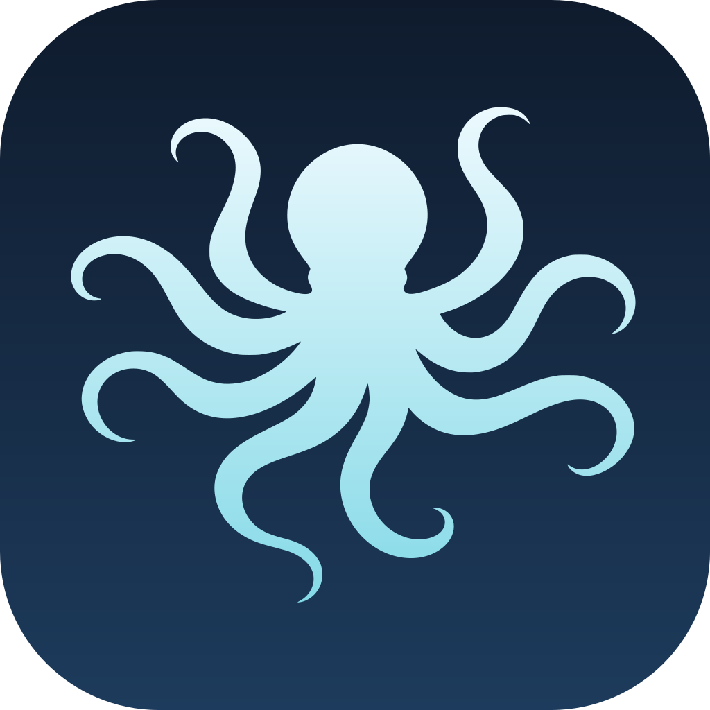
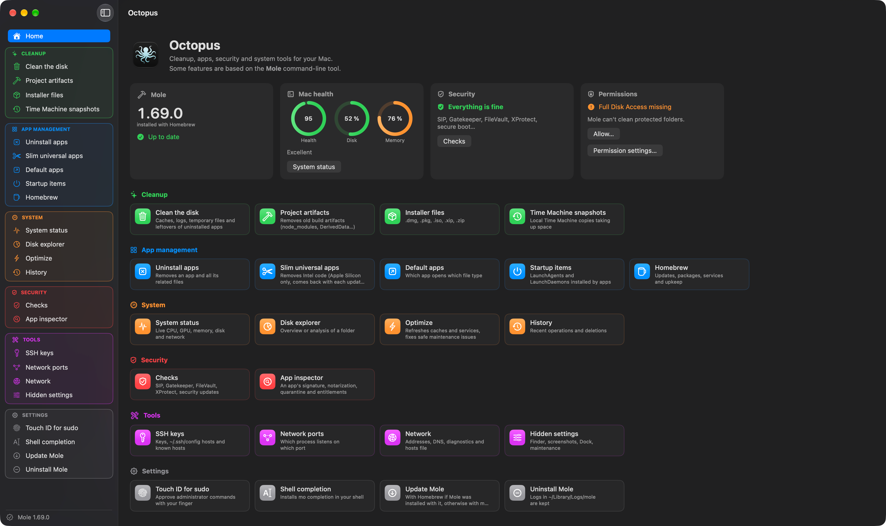
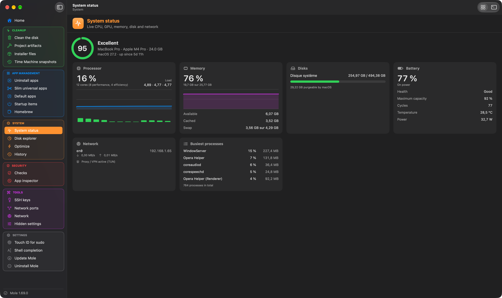
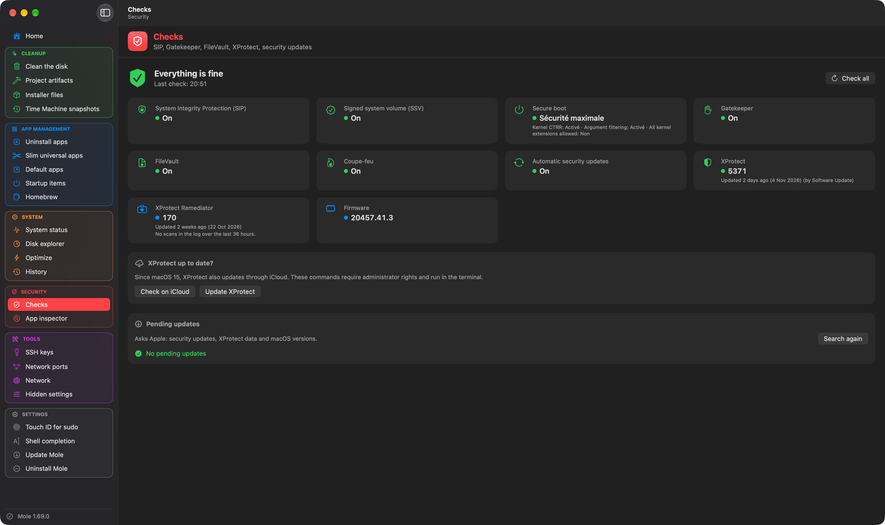
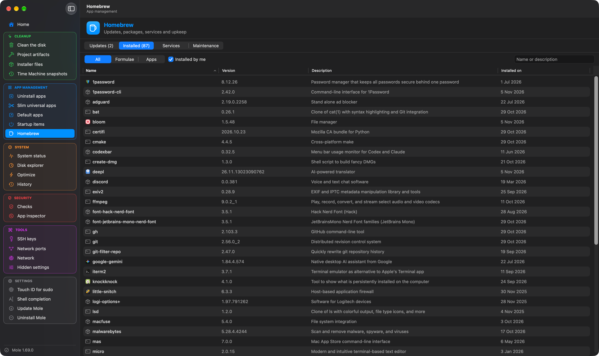
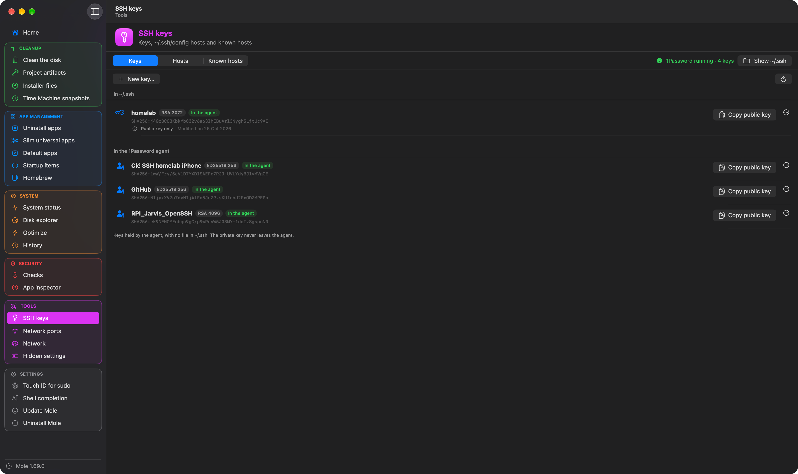

<p align="center">
  
</p>

<h1 align="center">Octopus</h1>

<p align="center">
  <a href="https://github.com/Aervorn/MacOS_Octopus/releases/latest"></a>
  
  
  <a href="LICENSE"></a>
</p>

<p align="center">
  🇬🇧 English · <a href="README.fr.md">🇫🇷 Français</a>
</p>

---

Octopus takes care of your Mac: cleanup, app management, security checks and system tools, in one native macOS window.

Its cleanup and maintenance functions are a graphical interface for [Mole](https://github.com/tw93/Mole), tw93's command-line tool: every Mole command, including those missing from the `mo` menu, is grouped by category with its options as checkboxes, and runs in a real embedded terminal (Mole's interactive screens, `sudo` and Touch ID work just like in Terminal). Around it, Octopus adds its own native tools: security checks in the spirit of [SilentKnight](https://eclecticlight.co/lockrattler-systhist/), SSH keys, network ports, startup items, Homebrew, hidden settings and more.

Octopus is available in English and French, following your Mac's language or the one chosen in its settings.

> [!NOTE]
> **Built with the help of AI.** Octopus is a personal project I built with [Claude](https://claude.ai), Anthropic's AI assistant: my skills alone wouldn't have been enough to code it entirely by myself. I decided what the app should do, made the design choices and tested every version on my own Mac; Claude wrote a large part of the code. Just being upfront about it.

> [!IMPORTANT]
> **Octopus isn't affiliated with Mole or its author.** It drives the `mo` installed on your Mac, without modifying it. Commands that delete files are Mole's: preview them first.

## 📸 Screenshots

<p align="center">
  
</p>

| System status | Security checks |
|:---:|:---:|
|  |  |
| **Homebrew** | **SSH keys** |
|  |  |

## ✨ Features

### 🏠 Home

Mac health, disk and memory at a glance, the result of the security checks, the installed Mole version (with an update button when a new one is out), Full Disk Access status, and a tile for every tool.

### 🧹 Cleanup (Mole)

- **Clean the disk**: caches, logs, temporary files and leftovers of apps already uninstalled. Protected paths can be edited.
- **Project artifacts**: old build artifacts (`node_modules`, `DerivedData`…), with the folders to scan.
- **Installer files**: `.dmg`, `.pkg`, `.iso`, `.xip`, `.zip` lying around.
- **Time Machine snapshots**: local snapshots, their size, and deletion.
- **Preview first**: `--dry-run` is checked by default on every command that deletes; a real run asks for confirmation. The generated command line is always shown before launch.

### 📦 App management

- **Uninstall apps** (Mole): an app and all its associated files.
- **Slim universal apps** (Mole, Apple Silicon): removes the Intel code.
- **Default apps**: which app opens which file type or URL scheme, and change it.
- **Startup items**: LaunchAgents and LaunchDaemons installed by apps, with their signature; enable, disable or reveal them, several at a time.
- **Homebrew**: outdated packages and one-click upgrades, installed formulae and casks (with the icon of each cask's app), services, cleanup and `autoremove`. Octopus also detects and repairs a cask stuck on “already an App at…”.

### 📊 System (Mole)

- **System status**: CPU, GPU, memory, disks, network, battery and the busiest processes, live.
- **Disk explorer**: the biggest folders and files of your Mac or of a folder, sortable, with reveal in Finder.
- **Optimize**: refreshes caches and services, fixes safe maintenance issues.
- **History**: Mole's recent operations and deletions.

### 🛡️ Security

- **Checks**: SIP, signed system volume, boot security policy, Gatekeeper, FileVault, firewall, automatic updates, XProtect and its last scans, firmware, and pending macOS and security updates (checked when the view opens).
- **App inspector**: signature, notarization, quarantine and entitlements of an app; removing the quarantine attribute.

### 🧰 Tools

- **SSH keys**: your keys and the agent's (1Password included), the hosts of `~/.ssh/config` with a form editor, known hosts, connection test, and sending a public key to a host.
- **Network ports**: which process listens on which port, with its command line; root processes too, with Touch ID.
- **Network**: addresses, router, DNS and public IP, diagnostics (ping, traceroute, DNS lookup, DNS cache flush) and the `hosts` file editor.
- **Hidden settings**: Finder, screenshots, Dock and maintenance options that are usually only reachable with `defaults write`.

### ⚙️ Mole itself

Touch ID for `sudo`, shell completion, and Mole updates: Octopus spots a new version and updates it with Homebrew or `mo update`, depending on how Mole was installed. If Mole is missing, Octopus offers to install it.

### 🎨 Interface

English or French, light, dark or automatic mode, color-coded sidebar sections and tool headers, and an embedded terminal ([SwiftTerm](https://github.com/migueldeicaza/SwiftTerm)) for Mole's colored output and keyboard-driven screens.

## 🧩 Compatibility

**macOS 14 (Sonoma) or later**, on Apple Silicon and Intel Macs. The new app icon adapts to the light, dark, clear and tinted icon styles of macOS 26.

[Mole](https://github.com/tw93/Mole) is needed for the cleanup, app uninstall and system functions: Octopus can install it for you. The other tools work without it. Homebrew is only needed for the Homebrew view.

## 🔐 Required permissions

| Permission | Why | When |
|---|---|---|
| **Full Disk Access** | Lets Mole clean protected folders, and the security checks read system logs. | Offered at first launch; can be granted later from **Settings › Permissions**. |
| **Administrator password / Touch ID** | Commands that need root (some checks, root ports, snapshots, `hosts`). | Only when you launch one of them. Touch ID is used if it's enabled for `sudo`. |
| **1Password** (optional) | Using the keys of the 1Password SSH agent. | When an SSH connection needs a key. |

## 🔒 Privacy

Octopus collects nothing and sends nothing about you: no account, no analytics, no tracking. The only network requests it makes itself are:

- the latest Mole version (GitHub);
- your public IP address, in the Network view ([ipify](https://www.ipify.org));
- Octopus updates (this GitHub repository);
- the tools you launch (Homebrew, `softwareupdate`, ping, SSH…), exactly as they would from Terminal.

## 📥 Installation

1. Download `Octopus-x.y.z.dmg` from the [latest release](https://github.com/Aervorn/MacOS_Octopus/releases/latest).
2. Open it and drag **Octopus** onto the **Applications** folder.
3. Launch Octopus from your Applications folder.

> [!WARNING]
> **Octopus isn't notarized by Apple.** It's signed with the author's own certificate, not with a paid Apple Developer account, so macOS blocks it the first time it's opened. This is expected; you only need to allow it once:
>
> 1. Open Octopus: macOS says it can't verify it. Click **Done**.
> 2. Open **System Settings › Privacy & Security** and scroll down to the **Security** section.
> 3. Next to the message about Octopus, click **Open Anyway**, then confirm with your password.
>
> If you prefer the Terminal: `xattr -dr com.apple.quarantine /Applications/Octopus.app`
>
> You can check that the download is genuine by comparing its SHA-256 checksum (`shasum -a 256 Octopus-x.y.z.dmg`) with the one given in the release notes.

## 🔄 Updating

Octopus updates itself: it checks for a new version once a day and offers to install it, with its release notes (or use **Octopus › Check for Updates…**). Updates are signed, and Octopus refuses any file that wasn't signed by the author. Automatic checking can be turned off in **Settings › General**.

## 📝 Changelog

### 0.1.0
- First public version, in English and French.
- Every Mole command with its options, run in an embedded terminal; Mole install and update.
- Native views for system status, disk explorer and history.
- Security checks, app inspector, SSH keys, network ports, network, startup items, Homebrew, Time Machine snapshots, default apps and hidden settings.
- Home view, light and dark mode, **About** window, app icon made for macOS 26, Sparkle updates.

## 🛠️ Building from source

Requirements: Xcode 26 or later and [XcodeGen](https://github.com/yonaskolb/XcodeGen) (the Xcode project is generated from `project.yml`).

```bash
brew install xcodegen
git clone https://github.com/Aervorn/MacOS_Octopus.git
cd MacOS_Octopus
xcodegen generate
open Octopus.xcodeproj
```

Choose the **Octopus** scheme and **My Mac**, then **Product › Run** (⌘R). The project is set to **Sign to Run Locally**: no Apple developer account is needed. After a `git pull` that adds or removes files, run `xcodegen generate` again.

```
Octopus/
├── OctopusApp.swift        entry point, windows and menus
├── Core/                   models of Mole's JSON output, command catalog, formatting
├── Services/               Mole, terminal, security checks, SSH, Homebrew, network, updates…
├── Views/                  SwiftUI interface (native tools in Views/Native)
├── Resources/              mole-commands.json: the catalog of Mole commands and their options
└── AppIcon.icon            app icon (Icon Composer)
Design/                     icon layers, DMG background and the scripts that generate them
scripts/make-dmg.sh         builds the DMG of a release and the Sparkle appcast
```

Mole commands are described in `Octopus/Resources/mole-commands.json` (title, options, actions): a new Mole option usually only needs a line there.

To build a DMG like the published ones, `scripts/make-dmg.sh` generates the project, archives the app, checks its signature and creates the disk image. It needs [create-dmg](https://github.com/create-dmg/create-dmg) (`brew install create-dmg`) and a signing certificate, whose name is set at the top of the script. It also signs the DMG for Sparkle and rewrites `appcast.xml`, which needs an EdDSA key in your keychain (`generate_keys`, shipped with Sparkle) whose public part is in `project.yml`.

## 🤝 Contributing & issues

Bug reports, ideas and pull requests are welcome!

- **Found a bug?** [Open an issue](https://github.com/Aervorn/MacOS_Octopus/issues/new) with your macOS version, your Mole version (`mo --version`), what you did and what happened.
- **A problem with a cleanup itself?** It probably comes from Mole: check whether it also happens with `mo` in Terminal, and if so, report it on [Mole's repository](https://github.com/tw93/Mole/issues).
- **A pull request?** Keep it focused on one change. Interface texts are written in French in the code and translated in `Octopus/Resources/Localizable.xcstrings` (and `Commands.xcstrings` for Mole commands).

## ⚠️ Disclaimer

Octopus is provided **“as is”, without any warranty**. Cleanup and system commands delete files and change settings: preview them, and keep a backup of your Mac. The author can't be held responsible for any data loss or other damage.

Octopus isn't affiliated with Mole, Apple, Homebrew, 1Password or The Eclectic Light Company. Their names are used only to describe how the app works.

## 📄 License

Octopus is released under the [MIT License](LICENSE).

It drives [Mole](https://github.com/tw93/Mole) (GPL-3.0), which isn't included and must be installed separately. The terminal uses [SwiftTerm](https://github.com/migueldeicaza/SwiftTerm) and updates use [Sparkle](https://sparkle-project.org), both released under the MIT License.
